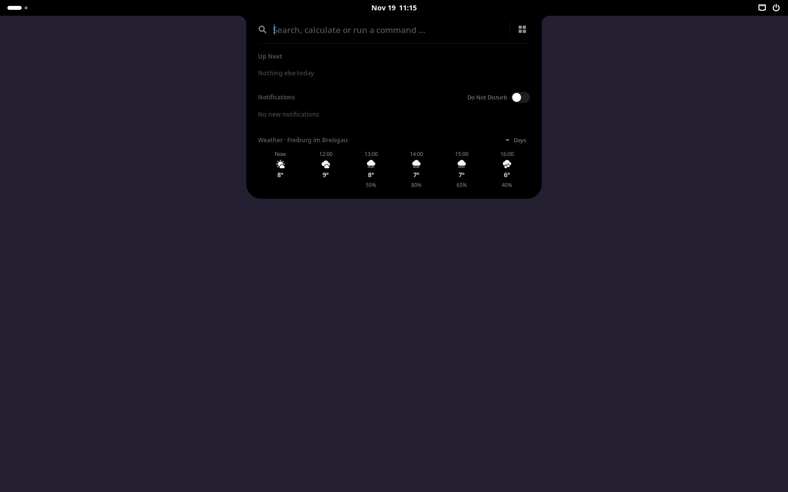
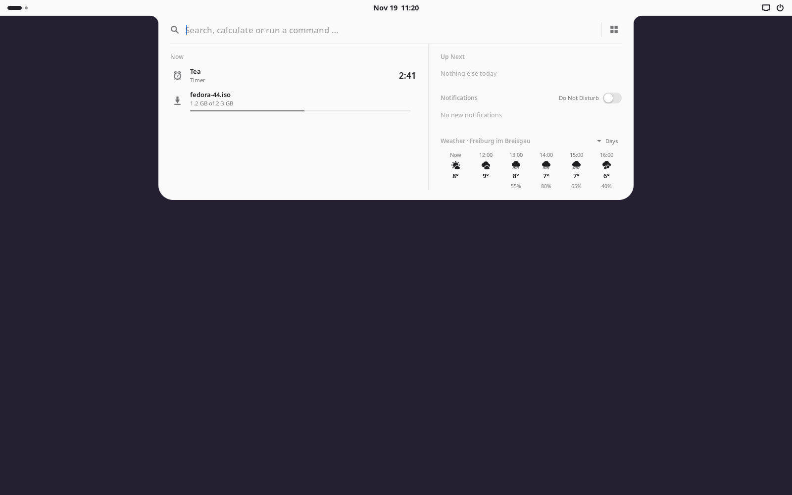

# Visor: Weather

**Visor: Weather – the weather at your place in the Visor notch for GNOME**

> Requires [Visor](https://github.com/taulit/visor). Shows the weather now, the next hours and the coming days for a place you choose.



This is a module for [Visor](https://github.com/taulit/visor), the notch for GNOME Shell 50/51. It is a GNOME extension of its own (`visor-weather@taulit.github.io`) and takes one place in Visor: a section in **Up Next**, the right column.



## What it shows

- **Now**: the temperature, what the weather is like, the place, the high and low of today and what it feels like.
- **The next six hours**: time, weather, temperature, and the chance of precipitation from 20 % on.
- **The coming four days**: weekday, weather, the chance of precipitation, low and high, and a bar that places the day between the coldest and the warmest of the days shown. The words for the weather ("Light snow") show where the section is wide enough; in the narrow right column the icon stands alone.
- **Refresh** appears at the right of the heading while the pointer is over the section.

Without a place the module shows nothing and makes no request.

## Choose the place

Open the settings of this extension (the gear next to "Weather" in the Modules page of Visor, or `gnome-extensions prefs visor-weather@taulit.github.io`), type the name of a city into **Search for a city**, press Enter and pick one of the places found. **Remove** takes it away again. The location of your machine is never looked up.

**Temperature** is Celsius or Fahrenheit. "Automatic" follows the region of the system (`LC_MEASUREMENT`): Fahrenheit in the United States and the few other countries that use it, Celsius everywhere else. Changing the unit asks no server; the data is kept in °C.

## When it asks for data

- Once when the module starts with a place, and when the place changes.
- When the panel opens and the data is older than 30 minutes, and every 30 minutes for as long as the panel stays open.
- When you press Refresh, and once when the network comes back after a request that failed.

While the panel is closed no timer runs: the module API of Visor asks modules to be quiet when idle. Until the answer is there the panel shows what it has; hours that have passed are dropped, and once the hour has changed the forecast for the current hour stands in for the measured weather.

Offline, or when the server does not answer, the last data stays and a quiet line says since when it was not updated ("Not updated since 14:05"). A forecast that no longer reaches the present, or a new place that could not be loaded yet, shows one line: "The weather is not available right now". The last data is kept in memory only; after a restart of the shell without a connection there is none.

## Privacy and network

The module has no account, no key, no telemetry and no server of its own. The weather data is by [Open-Meteo](https://open-meteo.com/) ([CC BY 4.0](https://open-meteo.com/en/licence)); its free API is meant for non-commercial use.

| Request                                                        | When                                                                           | What is sent                                                                                                                                | Turn it off                                                        |
| -------------------------------------------------------------- | ------------------------------------------------------------------------------ | ------------------------------------------------------------------------------------------------------------------------------------------- | ------------------------------------------------------------------ |
| Forecast: `https://api.open-meteo.com/v1/forecast`             | Only with a place chosen, at the moments listed under "When it asks for data". | Latitude and longitude of the place, rounded to two decimals (about one kilometre), and which values are wanted. Not the name of the place. | Remove the place in the settings, or turn the module off in Visor. |
| Place search: `https://geocoding-api.open-meteo.com/v1/search` | Only in the settings window, when you press Enter in "Search for a city".      | The text you typed and the language of your system (two letters), so the names come back in your language.                                  | Do not search.                                                     |

As with every request on the internet, the server sees the IP address it comes from. Redirects are not followed. The place (name and rounded coordinates) and the unit are stored in GSettings, on this machine only.

The two addresses are settings (`forecast-url`, `geocoding-url`), for an Open-Meteo instance you host yourself; they have no switch in the window:

```sh
gsettings --schemadir ~/.local/share/gnome-shell/extensions/visor-weather@taulit.github.io/schemas \
  set org.gnome.shell.extensions.visor-weather forecast-url 'https://weather.example.org/v1/forecast'
```

An address has to be https; plain http is accepted for this machine only. Anything else falls back to Open-Meteo.

## Install

From the [GNOME extension store](https://extensions.gnome.org/) (once released), or from a release ZIP:

```sh
gnome-extensions install --force visor-weather@taulit.github.io.shell-extension.zip
```

Log out and in again on Wayland, then enable the extension. Install and enable Visor as well.

## Build and test

Requires Node 22 or newer, pnpm, `glib-compile-schemas` (libglib2.0-bin), gettext and zip.

```sh
pnpm install
pnpm build      # build/ is an installable extension directory
pnpm pack:zip   # dist/<uuid>.shell-extension.zip, the file for extensions.gnome.org
```

| Script                | Purpose                                                                                |
| --------------------- | -------------------------------------------------------------------------------------- |
| `pnpm build`          | Compile TypeScript and assemble `build/`                                               |
| `pnpm pack:zip`       | Build and create the store ZIP                                                         |
| `pnpm lint`           | ESLint and `prettier --check`                                                          |
| `pnpm typecheck`      | Type-check with `tsc --noEmit`                                                         |
| `pnpm test`           | Unit tests of the forecast, the weather codes, the texts and the place search (Vitest) |
| `pnpm run test:shell` | The module next to Visor in a sandboxed headless GNOME Shell, see below                |
| `pnpm shots`          | The screenshots of `docs/screenshots/`, in the same sandbox                            |
| `pnpm pot`            | Regenerate `po/visor-weather.pot` and merge it into `po/*.po`                          |
| `pnpm sync:sdk`       | Update `src/visor/` from the npm package `@taulit/visor-module`                        |

The shell tests (`tests/shell/`: `weather`, `prefs`, `leak`) and the screenshots run against the mock server in `tests/mock/`, never against Open-Meteo. They use the sandbox of the Visor repository (`scripts/nested.sh`: own HOME, session bus and settings), so they need a checkout of Visor with `pnpm build` done, at `../visor` or where `VISOR_REPO` points:

```sh
VISOR_REPO=~/src/visor pnpm run test:shell        # all three, about one minute
pnpm run test:shell weather                       # one of them
```

The unit tests read two answers of the live API that were saved on 2026-11-19 (`tests/fixtures/`), and what the mock answers.

`src/visor/` holds copies of `connect.js` and the types of `@taulit/visor-module`: a GNOME extension has no `node_modules` at run time and no bundler.

### How it is built

The module API of Visor (v1) has rows, buttons and a line of quiet text, but nothing for a large number, a strip of columns or a bar. So the section is a `kit.section` whose body holds plain `St` widgets, styled in `stylesheet.css` through the classes `.visor-dark`, `.visor-light` and `.visor-hc` that Visor sets on its root, with the colours of Visor's own stylesheet (text, muted text, surfaces). Those classes are not part of the API contract; if Visor renames them the section loses its colours until this module follows.

## Not checked

- **A real session.** Everything ran in the sandboxed headless shell (GNOME Shell 50.5) with the mock server. The module was never installed in a logged-in session, and its section was never seen with data of the live API; only the two saved answers in `tests/fixtures/` come from it.
- **GNOME Shell 51**, a display scale other than 1, right-to-left languages and a screen reader. The hours and days carry an accessible name each, but nobody listened to it.
- **High contrast on a light panel** was only looked at with the class `visor-hc` set by hand (`docs/screenshots/high-contrast-light.png`): with the setting of the desktop the top bar, and the panel with it, is dark in both schemes here.
- **Suspend, a clock that jumps and a change to or from daylight saving time** between two answers. The logic for hours that pass is unit-tested; the real thing was not waited for.
- **Going offline and back** was tested with a server that answers 503, garbage or nothing; the retry on `network-changed` of `Gio.NetworkMonitor` was not exercised, because the sandbox has no network that goes away.
- **Every weather code in the shell.** The table of codes is unit-tested against the list Open-Meteo documents; on screen only the codes of the mock were seen (clear, clouds, rain, showers, snow), by day.
- **The twelve-hour clock** (`2 PM`) is unit-tested, not looked at in the shell.
- **The German translation** was written with this module and not checked by a second native speaker. Other languages are not translated.
- **The store.** The extension was not uploaded to extensions.gnome.org and not reviewed there; the release workflow has never run.

## Release

Push a tag such as `v1.0.0`: the workflow `.github/workflows/release.yml` builds the ZIP and attaches it to a GitHub release. Upload that ZIP to [extensions.gnome.org](https://extensions.gnome.org/upload/) by hand.

## License

GPL-2.0-or-later, like Visor. Weather data by [Open-Meteo](https://open-meteo.com/), CC BY 4.0.
